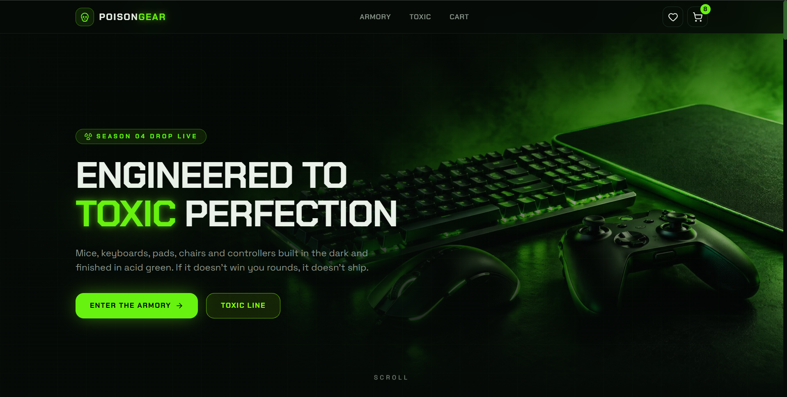
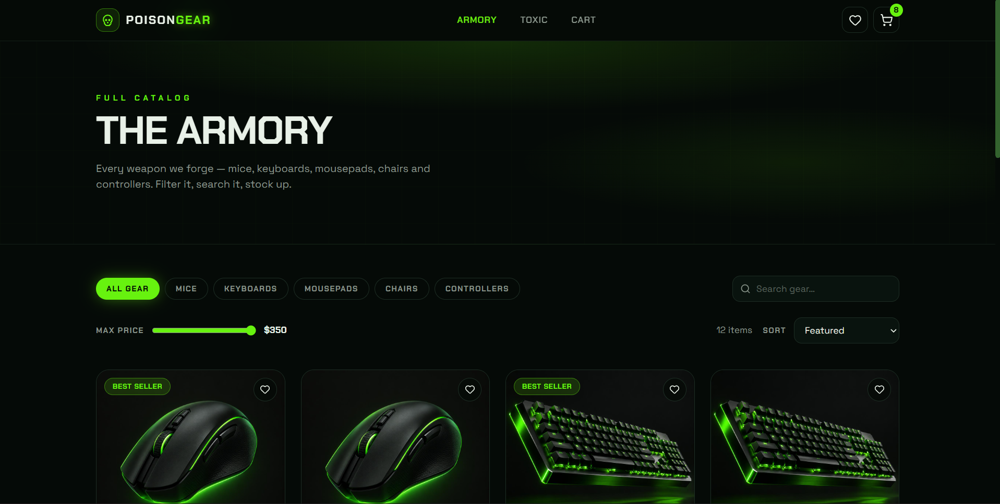
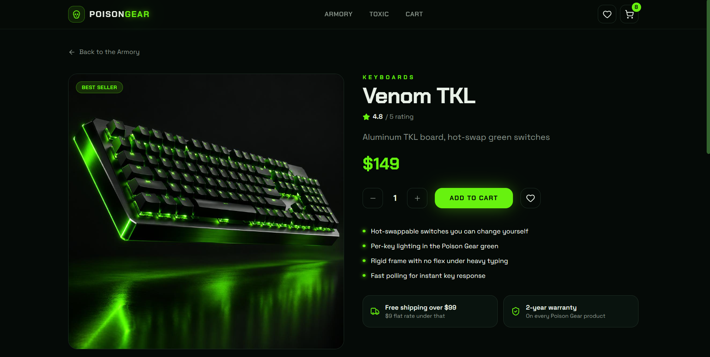
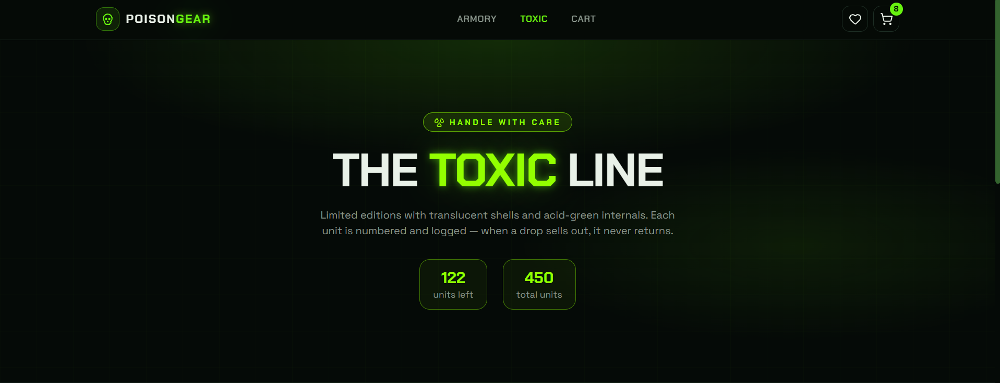
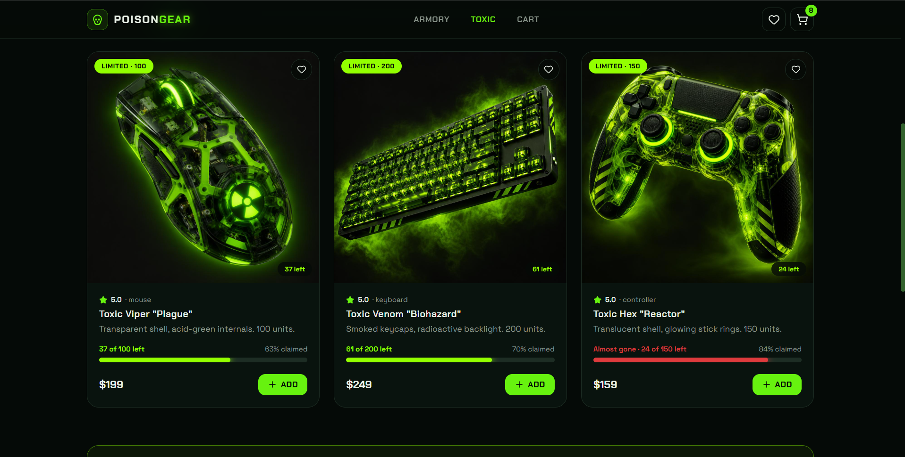
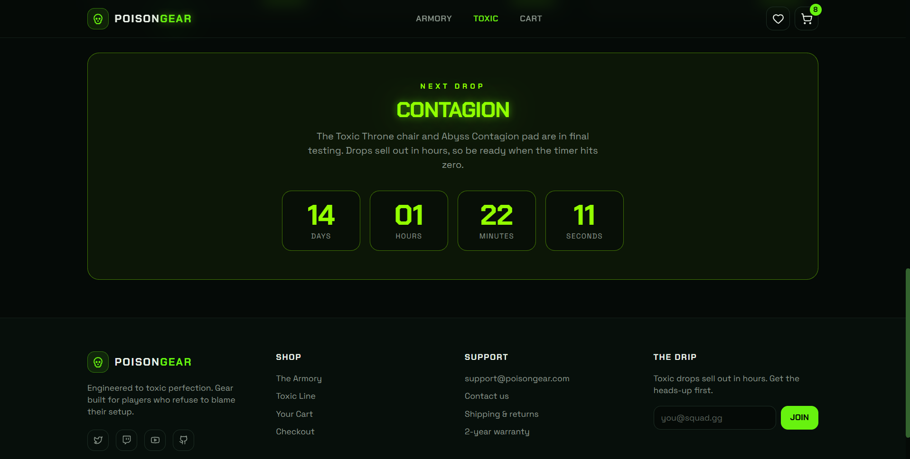
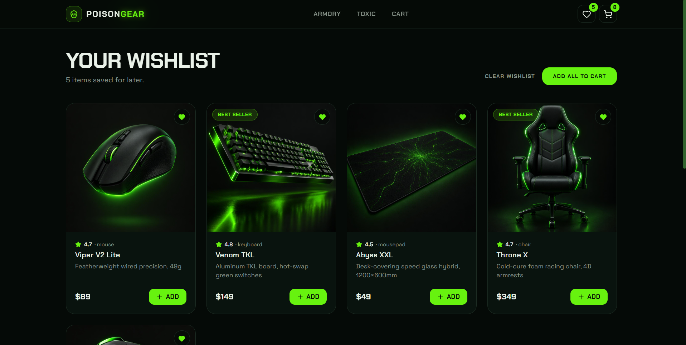
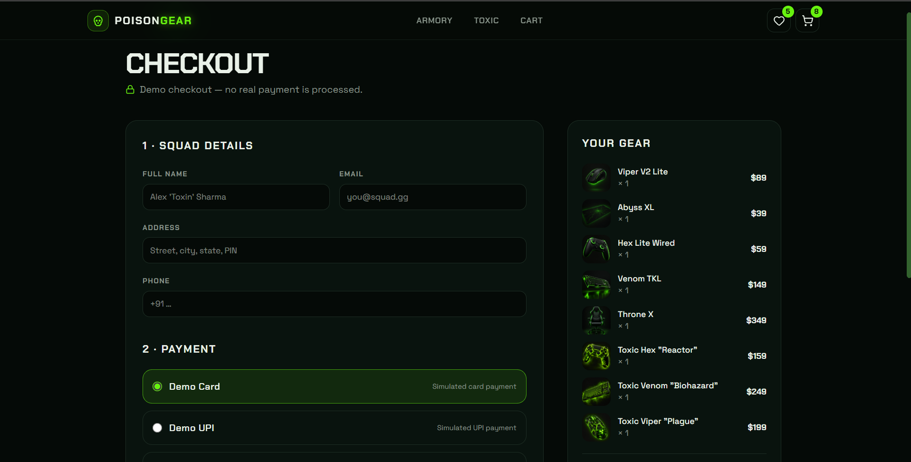
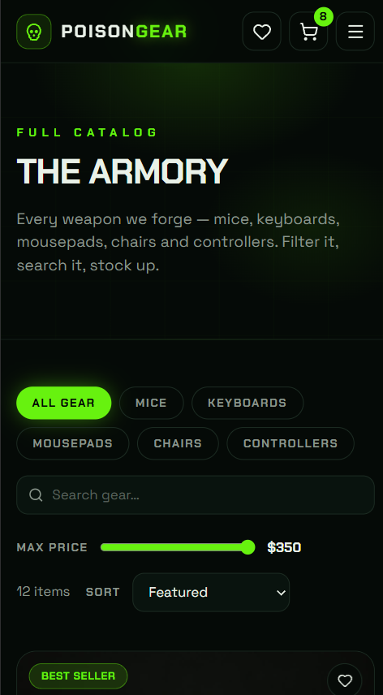

# Poison Gear

A gaming gear storefront with a black and toxic-green theme. Browse the catalogue, save favourites, fill a cart and run through a demo checkout.

**Live site:** https://poison-gear.vercel.app



## Features

- **Armory:** category filters, search, price slider and sorting
- **Product pages:** quantity picker, highlights and related products
- **Cart:** slide-in drawer plus a full cart page, with a free-shipping progress bar
- **Wishlist:** heart buttons on every product, saved in the browser
- **Toxic line:** limited editions with a live drop countdown and stock bars
- **Scroll story:** an animated section that opens up the flagship mouse as you scroll
- **Responsive:** mobile menu and layouts tuned for phones
- **Demo checkout:** order form with a confirmation screen (no real payments)

## Tech stack

- TanStack Start and TanStack Router
- React 19 and TypeScript
- Tailwind CSS v4 and shadcn/ui
- Framer Motion
- Deployed on Vercel

## Screenshots

### Shop

| Armory | Product page |
| --- | --- |
|  |  |

### Toxic line and limited drops

| Toxic line | Toxic line (continued) |
| --- | --- |
|  |  |



### Wishlist and checkout

| Wishlist | Checkout |
| --- | --- |
|  |  |

### Mobile



## Run it locally

```bash
git clone https://github.com/Nehil-nama/poison-gear.git
cd poison-gear
npm install
npm run dev
```

Then open http://localhost:3000.

## Notes

The cart and wishlist are stored in the browser's localStorage, and the checkout is simulated. There is no backend or payment provider yet.